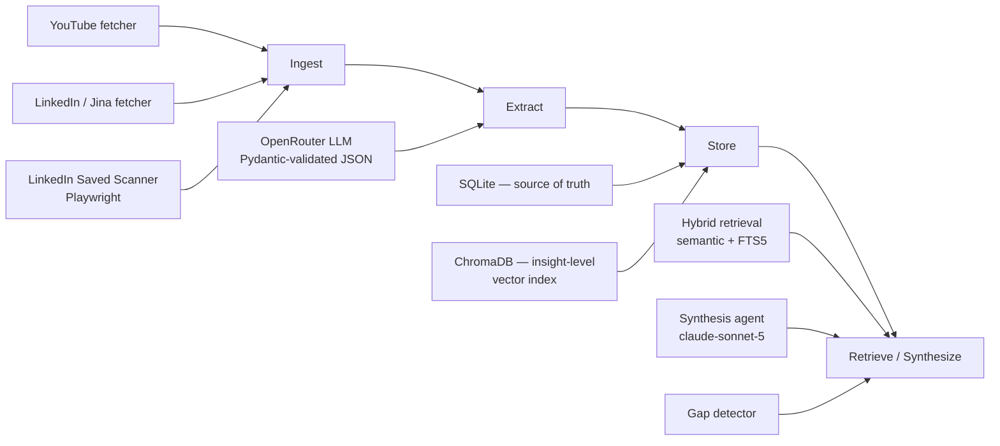

# ContentPilot

Agentic SME content aggregator for TPM interview prep — built with Python, ChromaDB, SQLite, Playwright, and OpenRouter.

## What it does

- Ingests YouTube videos, LinkedIn posts, and articles — including your own LinkedIn saved posts, scraped automatically on a weekly schedule.
- Extracts structured, TPM-lens insights (key learnings, build ideas, job-market signals) from each source via an LLM, with cost tracking and crash-safe batch processing.
- Answers real interview questions by retrieving relevant insights from your library and synthesizing a cited, structured answer — and tells you honestly which topics your library doesn't cover yet.

## Architecture



## Agentic patterns used

| Pattern | Where |
|---|---|
| Validated structured generation with self-correction (schema-validate, retry once with the error fed back) | `contentpilot/extraction.py`, `contentpilot/rag/synthesizer.py` |
| Hybrid retrieval with score fusion (semantic + lexical, re-ranked, auto-widens on thin results) | `contentpilot/rag/retriever.py` |
| Autonomous worker with job orchestration (polling loop, concurrency, exponential backoff, cost caps, crash recovery) | `contentpilot/worker.py` |
| Tool-using browser agent (Playwright session management, human-in-the-loop for 2FA/captcha) | `contentpilot/scrapers/linkedin_auth.py`, `contentpilot/scrapers/saved_posts.py` |
| Source-adaptive routing (dispatches each URL to the right fetcher strategy) | `contentpilot/fetchers/router.py` |
| Self-assessing confidence and gap detection (the system reasons about the limits of its own knowledge) | `contentpilot/rag/synthesizer.py` (confidence field), `contentpilot/rag/gap_detector.py` |

## Tech stack

| Tool | Purpose | Key file(s) |
|---|---|---|
| Streamlit | UI — home, Inbox, Search, Done log, interview prep | `Home.py`, `pages/` |
| SQLite (WAL mode) | Source of truth: sources, cards, jobs, flags | `contentpilot/db.py`, `contentpilot/storage.py` |
| SQLite FTS5 | Lexical search over card summaries/learnings | `contentpilot/db.py` (migration 4) |
| ChromaDB | Insight-level vector index, cosine distance | `contentpilot/storage.py` |
| OpenRouter | LLM access (extraction + synthesis) | `contentpilot/extraction.py`, `contentpilot/rag/synthesizer.py` |
| yt-dlp / youtube-transcript-api | YouTube metadata + transcripts | `contentpilot/fetchers/youtube.py` |
| Jina Reader | LinkedIn post / article text extraction | `contentpilot/fetchers/jina.py` |
| Playwright | LinkedIn login + saved-posts scraping | `contentpilot/scrapers/` |
| APScheduler | Weekly automated LinkedIn scan | `contentpilot/worker.py` |
| LangSmith (optional) | Tracing for extraction + synthesis calls | `contentpilot/tracing.py` |

## Setup

```bash
git clone <repo-url>
cd ContentPilot
pip install -r requirements.txt
playwright install chromium   # needed for the LinkedIn Saved Scanner

cp .env.example .env          # fill in your keys

# Terminal 1 — background ingest worker (also runs the scheduler)
python -m contentpilot.worker

# Terminal 2 — the app
streamlit run Home.py
```

## Screenshots

> _Add screenshots before publishing: card library, saved posts with flags, interview prep Q&A._

- `docs/screenshot-card-library.png`
- `docs/screenshot-saved-flags.png`
- `docs/screenshot-interview-prep.png`

## Why I built this

Interview prep for TPM roles usually means a static Notion doc: a pile of saved LinkedIn posts, half-watched YouTube talks, and a growing sense that you've "read about" topics without being able to speak to them under pressure. The actual bottleneck isn't finding good content — it's turning scattered content into answers you can give out loud, with real examples, on demand.

A static doc can't do that. It can't tell you that you've saved twelve posts about product strategy and zero about incident postmortems. It can't pull three sources together and draft the first pass of an answer you'd actually refine and practice. Agentic AI is what makes that gap closeable: a pipeline that keeps ingesting new material on its own, keeps the extracted insights queryable rather than buried in a feed, and can reason — at question time — not just about what to say, but about what it doesn't yet know well enough to say with confidence. That last part, the gap detection, is the piece a document can never give you.
